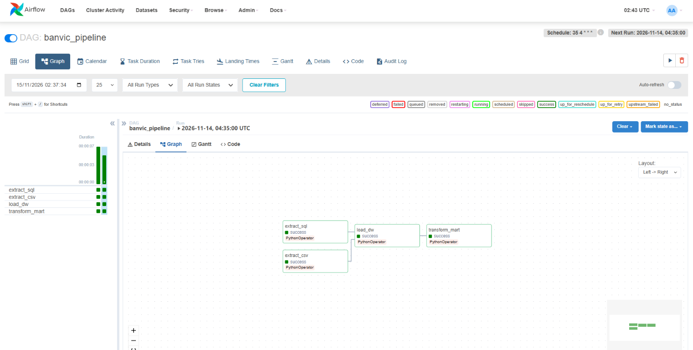

# Pipeline de Dados BanVic

Pipeline ELT do Banco Vitória (BanVic), orquestrada pelo Apache Airflow. A DAG extrai tabelas PostgreSQL e um arquivo CSV, salva os dados extraídos por data e carrega as tabelas no Data Warehouse.

## Arquitetura

- **Orquestração:** Apache Airflow 2.8.1 com Python 3.11.
- **Banco de dados:** PostgreSQL 16, provisionado com `banvic.sql`.
- **Fontes:** tabelas PostgreSQL e `include/transacoes.csv`.
- **Armazenamento da extração:** arquivos CSV organizados em `data/<data>/sql` e `data/<data>/csv`.
- **Camadas analíticas:** schemas `staging` e `mart`.
- **Agendamento:** diariamente às 04:35 (UTC, fuso padrão do Airflow).

As conexões `banvic_postgres` (fonte) e `dw_postgres` (destino) usam o mesmo serviço PostgreSQL `db`; os dados de origem ficam no schema `public`, e as tabelas carregadas ficam em `staging` e `mart`.

## Pré-requisitos

- Docker com Docker Compose v2 (`docker compose`).
- Porta `8080` disponível para a interface do Airflow.
- Porta `55432` disponível para acessar o PostgreSQL a partir da máquina local.

## Configuração e instalação

1. Na raiz do projeto, crie o arquivo local de configuração a partir do modelo:

   ```powershell
   Copy-Item .env.example .env
   ```

   Edite `.env` e substitua os valores de exemplo por senhas fortes e uma chave secreta própria. Não compartilhe nem faça commit desse arquivo; ele é ignorado pelo Git.

2. Inicie os serviços:

   ```bash
   docker compose up -d
   ```

   O Compose inicia o PostgreSQL do BanVic, o banco de metadados do Airflow, a inicialização do Airflow, o webserver e o scheduler. O arquivo `banvic.sql` é aplicado na primeira inicialização do volume do PostgreSQL.

3. Acesse [http://localhost:8080](http://localhost:8080) e entre com o usuário e a senha definidos pelas variáveis `AIRFLOW_ADMIN_USER` e `AIRFLOW_ADMIN_PASSWORD` no `.env`.

As conexões `banvic_postgres` e `dw_postgres` são configuradas automaticamente pelo Docker Compose usando as variáveis do `.env`; não é necessário cadastrá-las manualmente na interface do Airflow.

## Execução da pipeline

A DAG `banvic_pipeline` executa estas tarefas:

1. `extract_sql` e `extract_csv` rodam em paralelo. A primeira extrai as tabelas `agencias`, `clientes`, `colaboradores`, `colaborador_agencia`, `contas` e `propostas_credito`; a segunda lê `include/transacoes.csv`.
2. Ambas salvam seus resultados em `data/<data>/sql` ou `data/<data>/csv`, usando a data lógica da execução.
3. `load_dw` carrega os CSVs nos schemas `staging` e `mart`.
4. `transform_mart` atualiza `mart.resumo_agencias`, com totais de contas e clientes e saldos por agência.

Para executar manualmente, ative a DAG `banvic_pipeline` na interface do Airflow e dispare uma execução.



## Verificação dos dados

Abra uma sessão `psql` no serviço do banco:

```bash
docker compose exec db sh -lc 'psql -U "$POSTGRES_USER" -d "$POSTGRES_DB"'
```

No prompt do `psql`, confira os schemas e consulte algumas tabelas:

```sql
\dn
\dt staging.*
\dt mart.*

SELECT COUNT(*) FROM mart.sql_agencias;
SELECT COUNT(*) FROM mart.csv_transacoes;
SELECT COUNT(*) FROM mart.resumo_agencias;
```

## Estrutura do projeto

```text
.
├── dags/banvic_pipeline.py  # Definição da DAG e tarefas ELT
├── data/                    # Extrações por data (não versionadas)
├── images/dag.png           # Captura da DAG no Airflow
├── include/transacoes.csv   # CSV de entrada da pipeline
├── logs/                    # Logs do Airflow (não versionados)
├── banvic.sql               # Estrutura e dados iniciais do PostgreSQL
├── docker-compose.yml       # Serviços, volumes e conexões do Airflow
└── .env.example             # Modelo de configuração local
```

As extrações são repetíveis: o carregamento limpa as tabelas de destino antes de inserir os dados da execução. Os diretórios `data/` e `logs/` são locais e estão excluídos do controle de versão.
